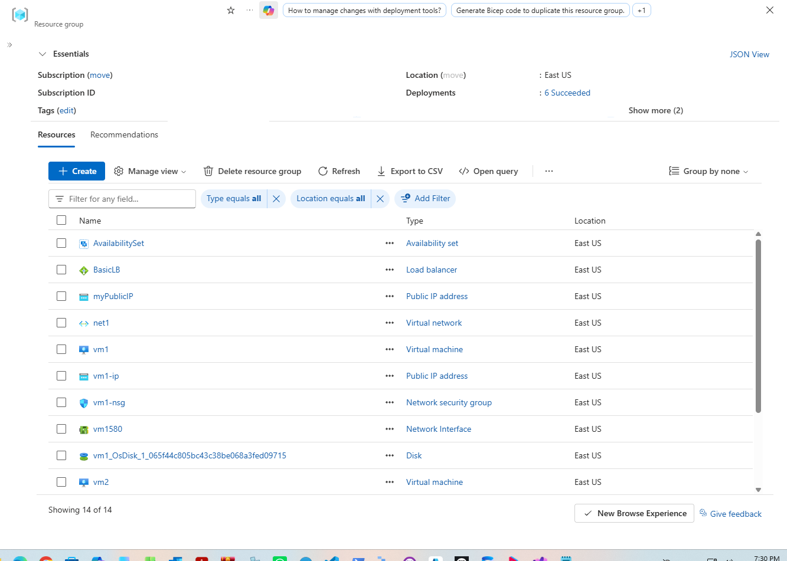
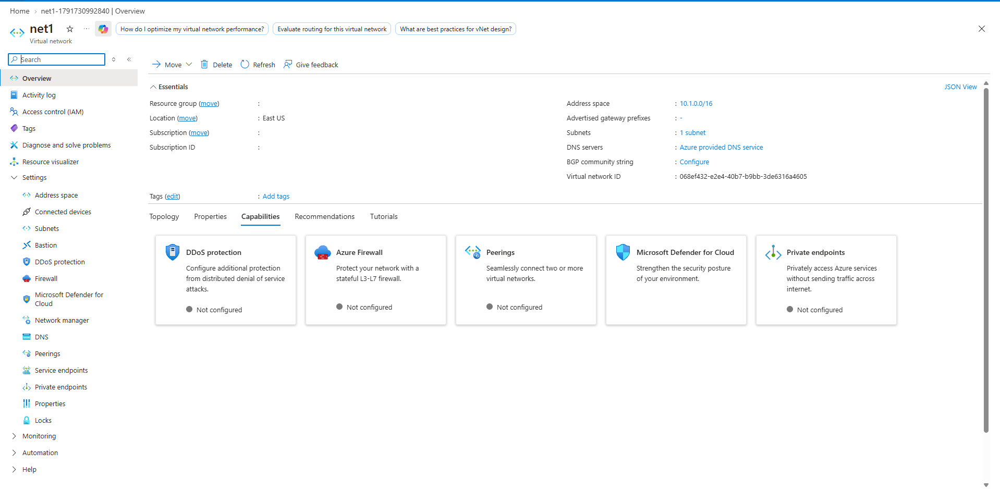
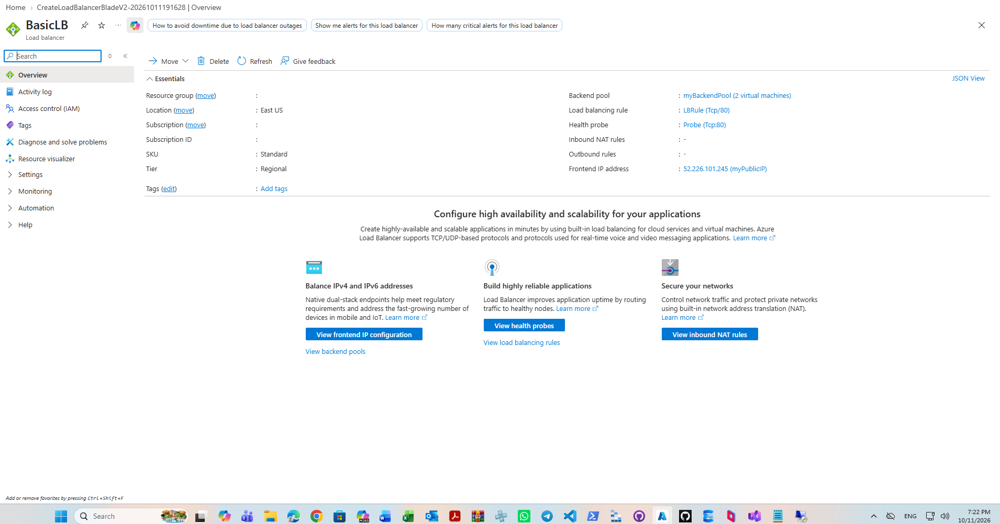
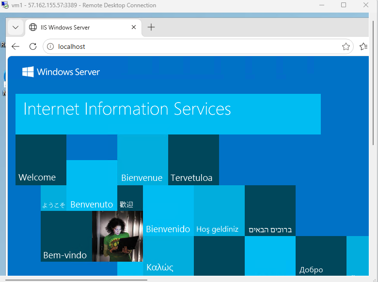
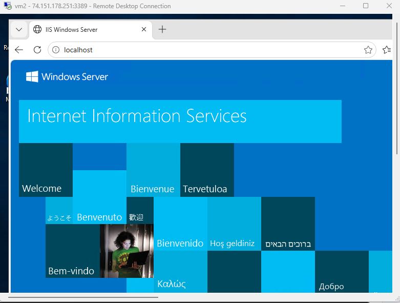
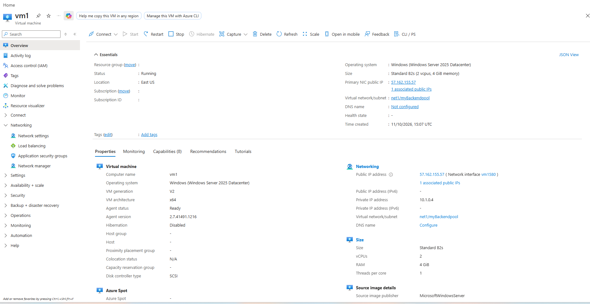
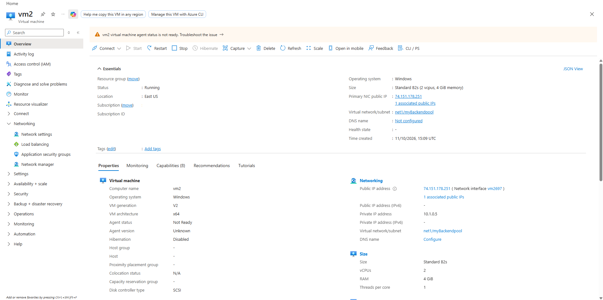
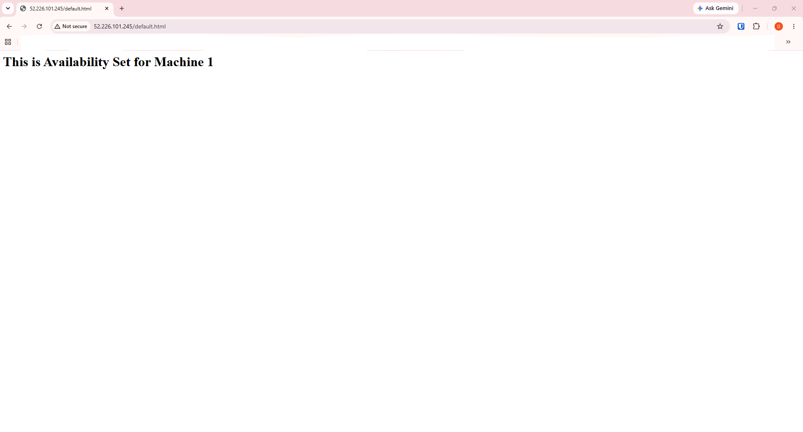
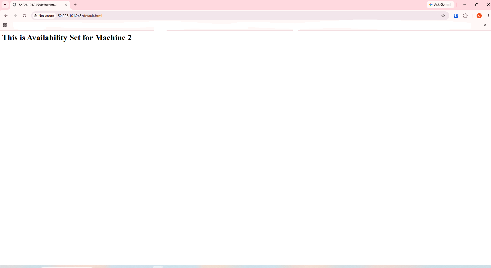

# Deploying and Configuring an Azure Basic Load Balancer with Backend Pool and Availability Set

Comprehensive documentation detailing the deployment of an Azure Basic/Standard Load Balancer (`BasicLB`) in the East US region configured with a public frontend IP, backend address pool, health probe, and load-balancing rules. The setup distributes incoming Layer 4 HTTP/TCP traffic across two Windows Server virtual machines (`vm1` and `vm2`) protected by Network Security Groups and organized within an Availability Set.

---

## 1. Architecture & Provisioned Resources

### Core Infrastructure Topology

| Resource Type | Resource Name | Specification / Tier | Region / Location |
| :--- | :--- | :--- | :--- |
| **Load Balancer** | `BasicLB` | Standard Tier, Regional | East US |
| **Frontend Public IP** | `myPublicIP` | Static Standard IPv4 (`52.226.101.245`) | East US |
| **Virtual Network** | `net1` | Address Space: `10.1.0.0/16` | East US |
| **Subnet** | `myBackendpool` | Address Prefix: `10.1.0.0/24` | East US |
| **Availability Set** | `AvailabilitySet` | Aligned (Fault Domains: 2, Update Domains: 2) | East US |
| **Virtual Machine 1** | `vm1` | Standard B2s, Windows Server 2025 Datacenter | East US |
| **Virtual Machine 2** | `vm2` | Standard B2s, Windows Server 2019 Datacenter | East US |

---

### Provisioned Environment Validation

*Resource group overview confirming the successful provisioning of the Load Balancer, public IP, virtual network, virtual machines, and availability set.*

---

## 2. Step-by-Step Implementation

### Step 1: Inspect Virtual Network Configuration

Reviewed the core virtual network (`net1`) layout and backend subnet configuration designed to host the backend compute instances.

* **Virtual Network:** `net1`
* **Address Space:** `10.1.0.0/16`
* **Subnet:** `myBackendpool` (`10.1.0.0/24`)

*Reviewing essentials and parameters for virtual network net1.*

---

### Step 2: Deploy and Verify Load Balancer

Inspected the deployed Load Balancer (`BasicLB`) configuration, confirming its frontend public IP association, backend address pool membership, and health probe settings.

* **Load Balancer Name:** `BasicLB`
* **Frontend Public IP:** `52.226.101.245` (`myPublicIP`)
* **Backend Pool:** `myBackendPool` (2 virtual machines)
* **Load Balancing Rule:** `LBRule` (TCP Port 80)
* **Health Probe:** `Probe` (TCP Port 80)

*Reviewing Load Balancer essentials, backend pool membership, and routing rules.*

---

### Step 3: Install Internet Information Services on Backend VMs

Established Remote Desktop connections to `vm1` and `vm2` to install the Web Server (IIS) role components, enabling them to serve HTTP responses.

* **Target Instances:** `vm1` and `vm2`
* **Role Installed:** Web Server (IIS)
* **Status:** Running and responsive

*Local validation of the default IIS landing page on vm1.*

*Local validation of the default IIS landing page on vm2.*

---

### Step 4: Verify Backend Virtual Machine Properties

Inspected the compute and networking properties for both virtual machines to confirm proper IP allocations and network interface bindings.

* **Virtual Machine 1:** `vm1` bound to private IP `10.1.0.4` and public IP `57.162.155.57`.
* **Virtual Machine 2:** `vm2` bound to private IP `10.1.0.5` and public IP `74.151.178.251`.

*Inspecting properties, private/public IP bindings, and network settings for vm1.*

*Inspecting properties, private/public IP bindings, and network settings for vm2.*

---

### Step 5: Validate Load Balanced Traffic Distribution

Tested incoming HTTP traffic sent to the Load Balancer's public frontend IP (`52.226.101.245`) to confirm that requests successfully hit the backend pool and rotate between `vm1` and `vm2`.

* **Frontend Target:** `http://52.226.101.245/default.html`
* **Validation Result:** Traffic successfully load-balanced across both backend nodes.

*Browser request routed by the Load Balancer to Machine 1.*

*Browser request routed by the Load Balancer to Machine 2.*
